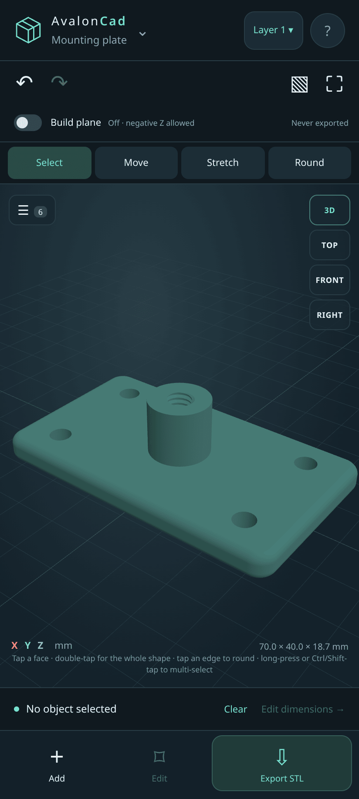
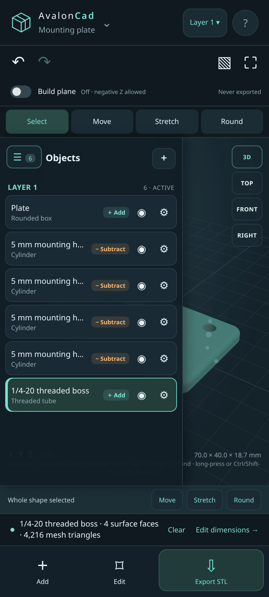
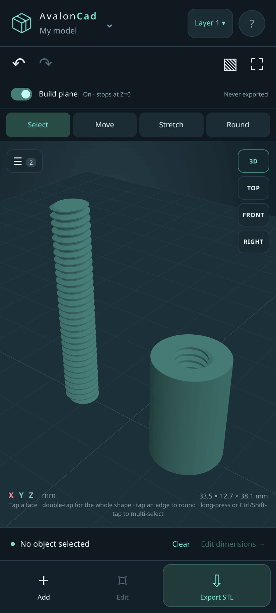
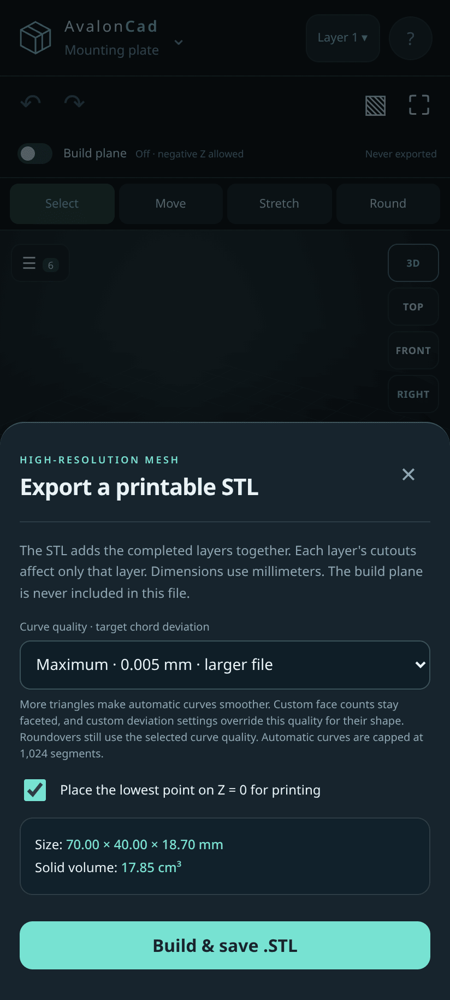

# AvalonCad

**Offline CAD for your phone.** AvalonCad lets you model dimensioned, 3D-printable parts with your fingers and export high-resolution STL files. It works without an internet connection. It is built mainly for Android, and there are desktop builds for Linux and Apple-silicon Macs.

<p align="center">
  
</p>

Every part is built from real solid geometry: primitives, true edge roundovers (fillets), helical threads, cutouts, layers and merges. All of the modeling runs on your device. There are no accounts, no servers and no runtime downloads.

- [Features](#features)
- [Download and install](#download-and-install)
- [How it works](#how-it-works)
- [Building from source](#building-from-source)
- [License](#license)
- [Changelog](CHANGELOG.md)

## Features

### Shapes with exact dimensions

Tap **Add** to open **Primitive Objects**: inclined plane (wedge), pyramid, box, rounded box, cylinder, cone, sphere, tube, all-thread screw and threaded tube. You can also draw a **custom sketch** by tapping points on the grid or typing them in, then extrude it to a height. STL files can be imported too.

- All dimensions are in millimeters and rotations are in degrees.
- Every new shape opens as a draft. Nothing is added until you tap **Apply & add object**. Cancel, Close, the shaded background and Android Back all throw the draft away.
- New shapes start with their **bottom center at X=0, Y=0, Z=0**. Apply first, then move or align them.
- **Smooth shape · high resolution** (on by default) keeps spheres, cylinders, cones, tubes and rounded boxes smooth at 0.005 mm curve resolution. **Edit → Face resolution** can also give any curved shape a fixed number of flat faces. For example, a 6-face "sphere" is cube-like and a 6-sided cylinder is a hexagonal prism.
- Any shape can be a **Solid** (adds material) or a **Cutout** (removes material on its own layer).

### Touch editing: Select, Move, Stretch, Round

<p align="center">
  
</p>

*Triple-tap an edge to select every edge on the shape, then drag or type a radius to round them.*

- **Select:** tap a face to highlight it. Double-tap to select the whole shape.
- **Move:** drag the shape or an X / Y / Z / XY handle. You can choose Free, 0.1 mm or 1 mm steps. **Snap on** shows center and face-center markers, and **Align centers** places shapes exactly against each other.
- **Stretch:** pull a face along its local axis, or use **Set size** to type an exact dimension. The opposite side stays put.
- **Round:** applies real solid edge fillets that are included in the STL. Tap an edge once for that edge, twice for the face perimeter, or three times for every sharp edge. Then drag up or down, or enter an exact radius.
- **Undo / Redo** covers every change, and live measurements appear while you drag.
- **Views and camera:** TOP, FRONT, RIGHT and 3D views, a fit button and a wireframe toggle. On a phone you pinch to zoom and use two fingers to pan. On desktop you scroll to zoom and right-drag to pan.

### Objects panel

<p align="center">
  
</p>

*Every shape in your model, grouped by layer, with show/hide and properties for each one.*

Tap the **☰** button in the corner of the 3D view to open the Objects panel. The button shows how many objects the model has.

- Shapes are grouped by layer. Each row shows whether the shape adds or subtracts material.
- The eye button hides or shows a shape, and the gear button opens its properties.
- Selection is shared both ways. Tap a row to highlight the shape in 3D, or tap a shape in 3D to highlight and scroll to its row.

### Multi-select, Merge and Create Prefab

<p align="center">
  
</p>

*Ctrl/Shift-click on desktop, or long-press on a phone, to select several shapes at once.*

- **Multi-select:** long-press a shape or row on a phone, or Ctrl/Shift-click on desktop.
- **Merge:** joins the selected shapes into one physically connected solid. By default, merged material fills any cutouts it overlaps. Turn on **Keep existing holes from overlapping Cutout shapes** to keep those holes. If the pieces don't touch, Merge can add connecting bars of a diameter you choose.
- **Create Prefab:** saves the selection as a reusable prefab in one step.

<p align="center">
  
</p>

### Threads

<p align="center">
  
</p>

*A 1/4-20 all-thread screw (1.5 in) and a matching internally threaded tube.*

- **All-thread screw** and **Threaded tube** are real single-start helical solids with a printable 60° profile.
- **Imperial** (inches and TPI, with fractions like `1 1/2`) or **Metric** (mm and pitch). New threads default to 1/4-20.
- Presets go from M3 × 0.5 to M20 × 2.5, plus #6-32 through 3/4-10. Custom diameter, pitch, length and right- or left-hand threads are also supported.
- **Radial fit clearance** loosens the fit for printing. Stretching a thread changes its length while the pitch stays fixed.

### Layers

<p align="center">
  
</p>

*Each layer builds its own material. Cutouts only cut their own layer.*

- Create and rename layers with the layer button at the top. New shapes go on the active layer, and **Edit → Layer** moves a shape to a different one.
- Cutouts affect only their own layer, so you can protect parts from a cut. All layers are added together for the preview and the STL.

### Prefabs

<p align="center">
  
</p>

*Save assemblies once and insert independent copies anywhere.*

- Save a selection, a layer or the whole model as a prefab. You can do this from **Add → Prefabs** or with **Create Prefab** in the Objects panel.
- Prefabs keep their shape parameters, roundovers and their own layer rules. Each insertion is an independent copy embedded in the project.
- Export and import portable **.avprefab** files. **Edit → Separate components** turns an inserted prefab back into editable shapes.

### Build plane

<p align="center">
  
</p>

*With the build plane on, nothing can sink below Z = 0.*

The **Build plane** switch keeps every shape at or above Z=0 while you move, resize, rotate or align. Shapes are lifted, never clipped. Turn it off to allow negative Z. The plane is only a visual guide and is never exported.

### STL export

<p align="center">
  
</p>

*Choose the curve quality, put the part flat on Z=0 and check its size and volume before saving.*

| Quality | Target chord deviation |
| --- | --- |
| Draft | 0.15 mm |
| Fine | 0.03 mm |
| Ultra | 0.01 mm |
| Maximum | 0.005 mm |

- Export writes a binary STL in millimeters with outward-facing normals. Curves are rebuilt at the quality you choose. Basic curves are capped at 1,024 segments.
- **Place the lowest point on Z = 0 for printing** drops the whole export onto the bed.
- Separate parts export together as separate closed shells.

### Projects and backups

- Your work autosaves on the device. You can keep named projects and export portable, editable **.tcad** files.
- Projects from AvalonCad 2.4 and earlier are **upgraded automatically** when you open them. Before an old autosave is replaced, it is copied to a backup.
- Limits: 100 objects per project, 300 points per sketch, 1 million triangles per imported STL and 50 MB file transfers.
- Not supported: constraint solving, chamfers, STEP files and automatic mesh repair.

## Download and install

Download the latest build from the [**GitHub Releases**](https://github.com/AvalonWaveSoftware/Avalon-CAD/releases) page.

### Android (APK)

Android 9 or later is required, and Android System WebView must support WebGL 2. Download `AvalonCad-<version>.apk`, open it from **My Files → Downloads** and choose **Update**.

- **Updating to 3.0:** 3.0 installs as a new app (`com.avalonwavesoftware.cad`) next to 2.7.x. To bring a project over, open it in 2.7.x, save it to a file, then open that file in 3.0. Once your projects are moved you can uninstall 2.7.x. Later 3.x releases install over 3.0 as usual.
- **Uninstalling** deletes local projects and prefabs. Export .tcad and .avprefab backups first.

### Linux (.rpm and Arch)

- **Fedora / RHEL / openSUSE:** install `avalon-cad-<version>.x86_64.rpm` with your package manager, e.g. `sudo dnf install ./avalon-cad-<version>.x86_64.rpm`.
- **Arch Linux:** `sudo pacman -U avalon-cad-<version>-1-x86_64.pkg.tar.zst`.

Both packages install to `/opt/Avalon CAD` with an `avalon-cad` launcher and a desktop entry. Data is stored under `~/.config/Avalon CAD/`. WebGL 2 is required. If your GPU driver misbehaves, run with `AVALON_SOFTWARE_GL=1` to switch to software rendering.

### macOS (Apple silicon)

1. Download `AvalonCad-<version>-Mac-AppleSilicon.zip` and double-click it to extract it.
2. Move **AvalonCad.app** to **Applications** and open it. It needs macOS 13 or later, and everything it needs is bundled.
3. The app is **not notarized by Apple**. If macOS blocks it, go to **System Settings → Privacy & Security** and click **Open Anyway** for AvalonCad, then confirm. See [Apple's guide](https://support.apple.com/en-us/102445). Don't change your system-wide Gatekeeper setting.

**Mac controls:** left-drag to orbit. Right-drag, Shift-drag or Cmd/Ctrl-drag to pan. Scroll or pinch to zoom.

**Mac shortcuts:**

| Shortcut | Action |
| --- | --- |
| Cmd+N | New project |
| Cmd+O | Open a .tcad, .avprefab or STL file |
| Cmd+S | Save |
| Cmd+Shift+S | Export .tcad |
| Cmd+E | STL export |
| Cmd+Z / Cmd+Shift+Z | Undo / Redo |
| Cmd+0 | Fit view |
| Esc | Close a panel or clear selection |

To move work between devices, export a .tcad from your phone and open it on the desktop with File → Open.

## How it works

AvalonCad is a web app bundled inside each platform's own app shell: an Android WebView, or Electron on desktop. It runs entirely offline:

- **Python (Pyodide, CPython 3.13.2)** handles model assembly and Boolean jobs in a background worker.
- **Rust compiled to WebAssembly** builds threaded solids, prepares preview meshes and normals, and writes binary STL and 3MF.
- **OpenCascade** (via replicad) and **Manifold** provide solid modeling, Booleans and true edge fillets.
- **three.js** draws the WebGL 2 viewport.

The Android app has **no internet permission**. The desktop shells block every outside request. There are no accounts, ads or analytics, and nothing is downloaded at runtime.

## Building from source

The source tree contains the Python and Rust engine source, web and Android code, bundled runtime assets, tests and dependency lockfiles. Python job code lives in `engine/python/model_jobs.py`, and the Rust engine is in `engine/rust/src/lib.rs`. The CAD kernel is a separate WASM asset that can be rebuilt from its upstream source.

### Android APK (Linux)

Install Node.js 20 or later (24+ recommended for development), a Java 17 JDK, and Rust 1.90.0 with its `wasm32-unknown-unknown` target. Install the Android command-line tools into `tools/android-sdk/cmdline-tools/latest`, or set `TRISTANCAD_SDK` to your SDK. Then install `platforms;android-35` and `build-tools;35.0.0` with `sdkmanager`, accepting the license when prompted.

```bash
rustup toolchain install 1.90.0 --profile minimal --target wasm32-unknown-unknown
npm ci
./build-rust.sh
cargo test --locked --offline --manifest-path engine/rust/Cargo.toml --target-dir build/rust-target
npm test
./build-apk.sh
```

The APK is written to a sibling `deliverables/` directory. The Rust crate's only dependency, miniz_oxide (DEFLATE for 3MF export, with its adler2 dependency), is vendored in `engine/rust/vendor` (see `.cargo/config.toml`), so it builds offline once the pinned compiler and target are installed. The build pins Pyodide 0.29.3 (CPython 3.13.2) and bundles its unmodified runtime with full license notices.

**Signing:** the APK is signed with the private key `tools/signing.p12`. Set its password in the `AVALONCAD_KEYSTORE_PASS` environment variable before running `build-apk.sh`, because the password is not stored in the repository. Keep the existing key so new APKs can update installed apps. If the key is missing, `build-apk.sh` stops instead of silently creating a new one; set `AVALON_ALLOW_NEW_KEY=1` only if you really mean to create one. **Never commit the signing key or its password**, and keep any source backup that contains the key private.

### Desktop

- **Mac:** on a Mac with Node.js 24+, run `npm ci` and then `npm run build:mac`. This builds the web assets, downloads a pinned Electron runtime and checks its SHA-256, packages an arm64 `.app` and signs it locally with `codesign`. For cross-platform signing, set `AVALON_RCODESIGN` to an apple-codesign executable and `AVALON_ELECTRON_CACHE` to a folder containing the verified runtime ZIP.
- **Linux:** run `desktop/build-rpm.sh` or `desktop/build-arch.sh`. Add `--skip-web` to reuse the existing `app/assets`. See [desktop/README.md](desktop/README.md) for the requirements and a headless smoke test.

### Tests

- `app/assets` is generated and not tracked (except `mesh-core.wasm`): run `npm run build:web` before `npm test` or the browser tests. The packaging scripts always build it.
- The first `npm run build:web` on a machine runs binaryen `wasm-opt -Oz` on the OCCT and Manifold binaries (about 4 minutes, up to ~8 GB of memory); the result is cached in `build/wasm-opt`. `tools/npm-stubs` holds empty stand-ins for install-only dependencies (see its README).
- `npm test` runs the geometry, interaction, layer, prefab, thread, build-plane, Objects panel and migration suites in Node using jsdom. Node 24 is recommended.
- `npm run test:browser` is an optional integration test with real WebGL. Install Playwright separately (`npm install --no-save playwright`) and set `AVALON_CHROMIUM` to a local Chromium executable. It serves the bundled assets from localhost only and blocks all outside requests. This test server is a development tool and is not part of the installed app.
- `tools/readme-shots/` contains the Playwright script that produces the screenshots in this README.

## License

AvalonCad is released under the [BSD-3-Clause license](LICENSE). Bundled third-party components keep their own licenses. See [THIRD_PARTY_NOTICES.txt](THIRD_PARTY_NOTICES.txt) and the [licenses/](licenses/) folder.

See [CHANGELOG.md](CHANGELOG.md) for the release history.
