# AvalonCad 3.0

**Offline CAD for dimensioned, 3D-printable parts.** AvalonCad runs on Android phones and tablets, on Linux and on Apple-silicon Macs. You model with real solid geometry, check exact measurements, and export STL or 3MF files for your slicer. Everything runs on your device: there are no accounts, no servers and no runtime downloads.

## Threaded screw presets

Pick **Add → All-thread screw** (or **Threaded tube**), choose a common size from the preset list, set a length and apply. The thread is a real helical solid, not a texture, so it prints and it mates.

<p align="center">
  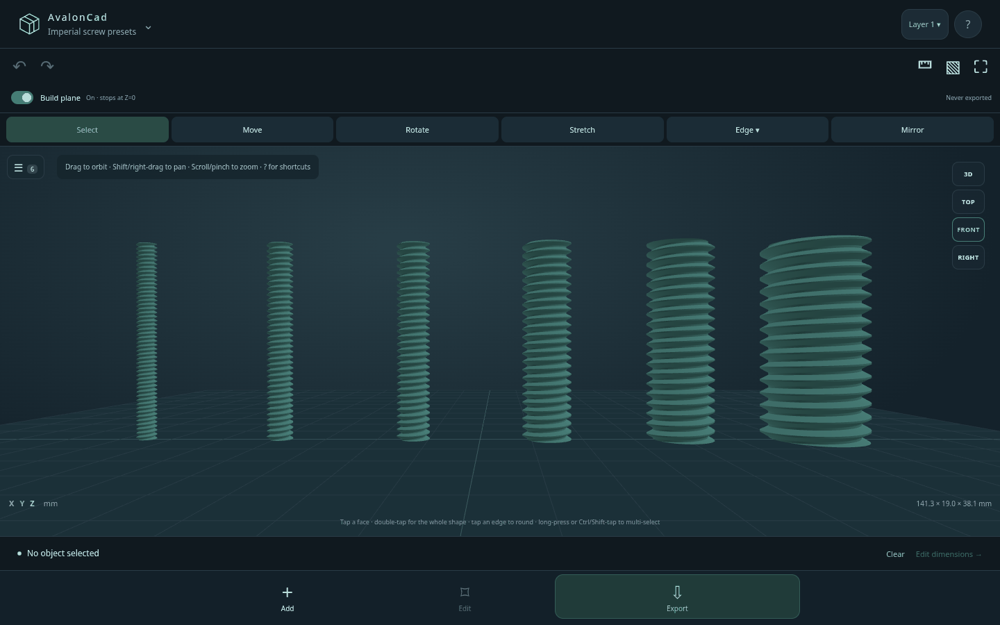
</p>

*Imperial presets, left to right: #6-32, #10-24, 1/4-20, 3/8-16, 1/2-13 and 3/4-10, each 1.5 in long.*

<p align="center">
  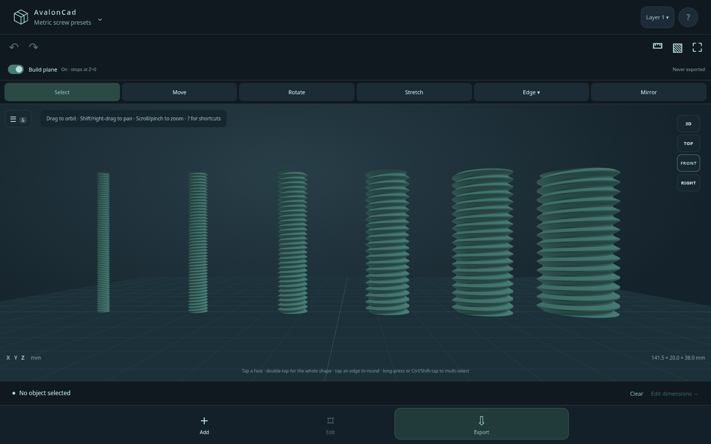
</p>

*Metric presets, left to right: M3 × 0.5, M5 × 0.8, M8 × 1.25, M12 × 1.75, M16 × 2 and M20 × 2.5, each 38 mm long.*

<p align="center">
  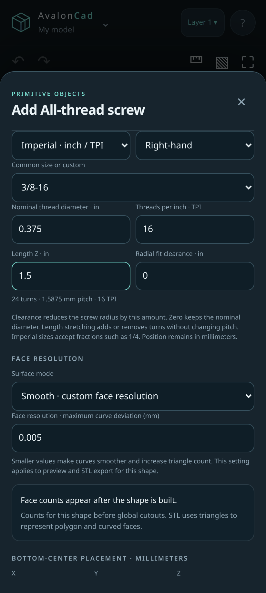
  &nbsp;&nbsp;
  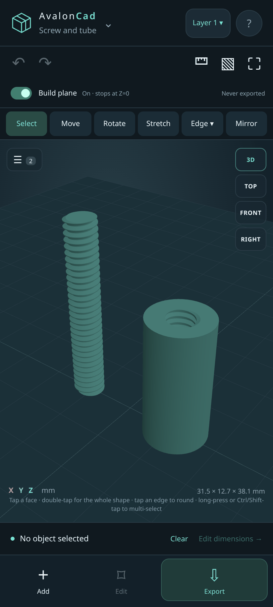
</p>

*Left: the preset list in the screw sheet (3/8-16, 1.5 in). Right: a 1/4-20 screw and a matching 1/4-20 threaded tube.*

<p align="center">
  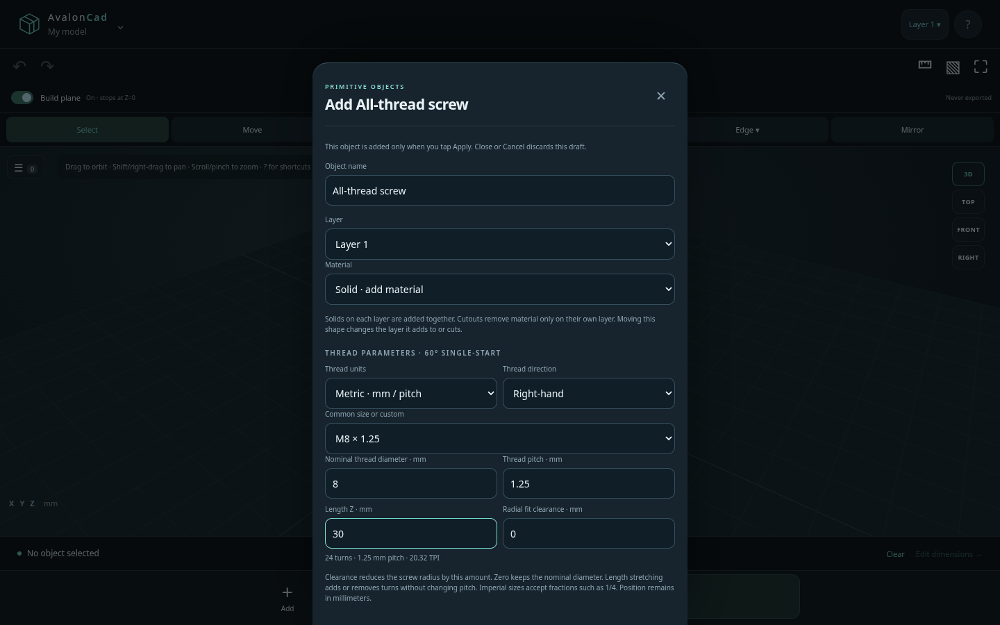
</p>

*The same sheet on the desktop app, set to Metric with the M8 × 1.25 preset and a 30 mm length.*

- **24 presets in two unit systems** (9 metric and 15 imperial). Choose **Imperial · inch / TPI** or **Metric · mm / pitch** under **Thread units**, then pick the size under **Common size or custom**. New threads start Imperial at 1/4-20.
- **Custom sizes.** Enter your own nominal diameter, pitch (or TPI), length, radial fit clearance and **Right-hand** or **Left-hand** direction. Imperial fields accept decimals or fractions such as `1/4` and `1 1/2`. Editing a field switches the list back to **Custom parameters**.
- **Check the thread before you apply.** The sheet shows the turn count, pitch and TPI, for example "24 turns · 1.5875 mm pitch · 16 TPI".
- **Printable fit.** **Radial fit clearance** reduces a screw's radius, or enlarges a threaded tube's bore, by that amount. Threads use a 60° single-start profile with flat crests and roots.
- **Stretch without changing the pitch.** Stretching a screw or tube along its length adds or removes whole turns while the pitch, diameter and thread phase stay fixed.
- **Limits.** Threads are not certified ISO or ASME fit classes, and there are no tapered pipe threads, multi-start threads, screw heads or lead-in chamfers. Positions stay in millimeters. Inch input does not put inch units into the STL.

<details>
<summary>All presets (diameter and pitch, as built into the app)</summary>

| Metric | Nominal diameter | Pitch |
| --- | --- | --- |
| M3 × 0.5 | 3 mm | 0.5 mm |
| M4 × 0.7 | 4 mm | 0.7 mm |
| M5 × 0.8 | 5 mm | 0.8 mm |
| M6 × 1 | 6 mm | 1 mm |
| M8 × 1.25 | 8 mm | 1.25 mm |
| M10 × 1.5 | 10 mm | 1.5 mm |
| M12 × 1.75 | 12 mm | 1.75 mm |
| M16 × 2 | 16 mm | 2 mm |
| M20 × 2.5 | 20 mm | 2.5 mm |

| Imperial | Nominal diameter | Threads per inch |
| --- | --- | --- |
| #6-32 | 0.138 in (3.51 mm) | 32 TPI (0.794 mm pitch) |
| #8-32 | 0.164 in (4.17 mm) | 32 TPI (0.794 mm pitch) |
| #10-24 | 0.190 in (4.83 mm) | 24 TPI (1.058 mm pitch) |
| #10-32 | 0.190 in (4.83 mm) | 32 TPI (0.794 mm pitch) |
| 1/4-20 | 0.250 in (6.35 mm) | 20 TPI (1.270 mm pitch) |
| 1/4-28 | 0.250 in (6.35 mm) | 28 TPI (0.907 mm pitch) |
| 5/16-18 | 0.3125 in (7.94 mm) | 18 TPI (1.411 mm pitch) |
| 3/8-16 | 0.375 in (9.52 mm) | 16 TPI (1.587 mm pitch) |
| 3/8-24 | 0.375 in (9.52 mm) | 24 TPI (1.058 mm pitch) |
| 1/2-13 | 0.500 in (12.70 mm) | 13 TPI (1.954 mm pitch) |
| 1/2-20 | 0.500 in (12.70 mm) | 20 TPI (1.270 mm pitch) |
| 1/2-28 | 0.500 in (12.70 mm) | 28 TPI (0.907 mm pitch) |
| 5/8-11 | 0.625 in (15.88 mm) | 11 TPI (2.309 mm pitch) |
| 5/8-24 | 0.625 in (15.88 mm) | 24 TPI (1.058 mm pitch) |
| 3/4-10 | 0.750 in (19.05 mm) | 10 TPI (2.540 mm pitch) |

</details>

## Contents

- [The app](#the-app)
- [What's new in 3.0](#whats-new-in-30)
- [Feature set](#feature-set)
- [Install](#install)
- [How it works](#how-it-works)
- [Building from source](#building-from-source)
- [License](#license)
- [Changelog](CHANGELOG.md)

## The app

The same web app runs in an Android WebView and in Electron on Linux and the Mac, so every platform has the same layout: a mode bar (**Select, Move, Rotate, Stretch, Edge ▾, Mirror**), the 3D view with an **Objects** panel, and **Add, Edit** and **Export** at the bottom.

<p align="center">
  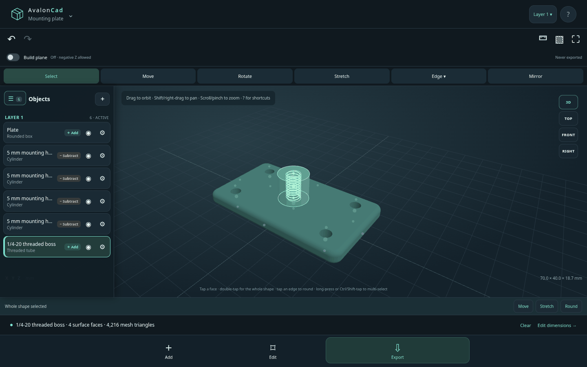
</p>

*Desktop: a mounting plate with a 1/4-20 threaded boss, with the Objects panel open and the boss selected.*

<p align="center">
  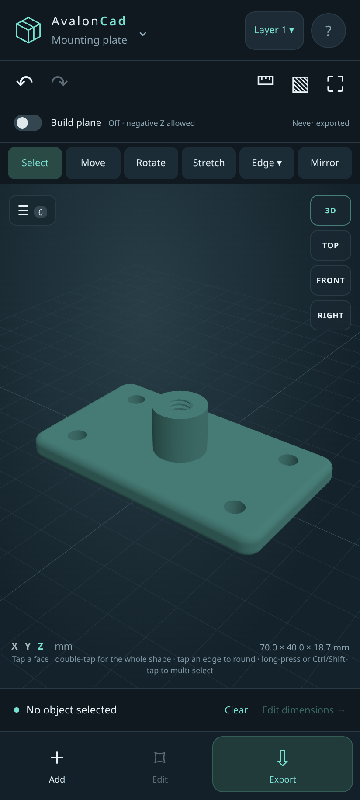
  &nbsp;&nbsp;
  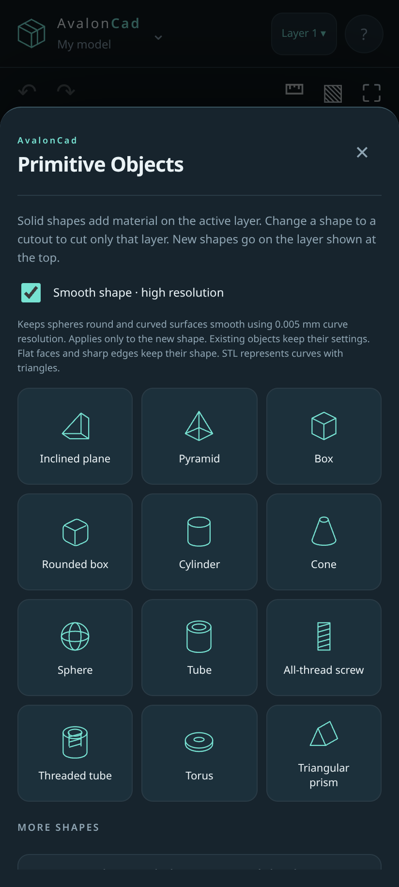
</p>

*Phone: the same project, and the Primitive Objects sheet that Add opens.*

## What's new in 3.0

- **Import STL and 3MF files.** Opened meshes become editable objects (move, rotate, stretch, cutout), and 3MF is also an export format.
- **Rotate handles** (R): three rings turn an object about the world axes, in 15° steps or freely.
- **Hollow (shell) objects:** hollow a shape with a wall thickness and leave faces open.
- **Letters with a plate:** add letters, numbers and symbols on an embossed or engraved plate, with the part's **Overall size** shown.
- **Mirror, groups, measure, chamfer, inch units, overhang view,** keyboard shortcuts and tooltips.
- **A job bar with Cancel** for slow imports, exports and checks, and many Android memory and recovery fixes.
- **A new app ID, `com.avalonwavesoftware.cad`, and on Android a new signing key**, so Android installs 3.0 as a new app next to 2.7.x. See [Install](#android-apk).

The full list is in the [changelog](CHANGELOG.md).

## Feature set

### Shapes with exact dimensions

Tap **Add** to open **Primitive Objects**: inclined plane, pyramid, box, rounded box, cylinder, cone, sphere, tube, all-thread screw, threaded tube, torus and triangular prism. **Advanced shapes** adds a tetrahedron, octahedron, decahedron (d10), dodecahedron and icosahedron. **Letters, numbers & symbols** has 94 tiles. You can also draw a **custom sketch** by tapping points on the grid or typing them in, then extrude it to a height, or import a file.

- Dimensions are in millimeters by default, and rotations are in degrees. A **mm | in** switch in the Edit dimensions header changes every dimension, readout, drag step and the grid to inches; projects and STL files stay in millimeters.
- Every new shape opens as a draft. Nothing is added until you tap **Apply**. Close, Cancel and Android Back all throw the draft away.
- New shapes start with their **bottom center at X=0, Y=0, Z=0**. Apply first, then move or align them.
- **Smooth shape · high resolution** (on by default) keeps curved shapes smooth at 0.005 mm curve resolution. **Face resolution** can instead give any curved shape a fixed number of flat faces.
- Any shape can be a **Solid** (adds material) or a **Cutout** (removes material on its own layer).

### Touch and mouse editing: Select, Move, Rotate, Stretch, Edge, Mirror

<p align="center">
  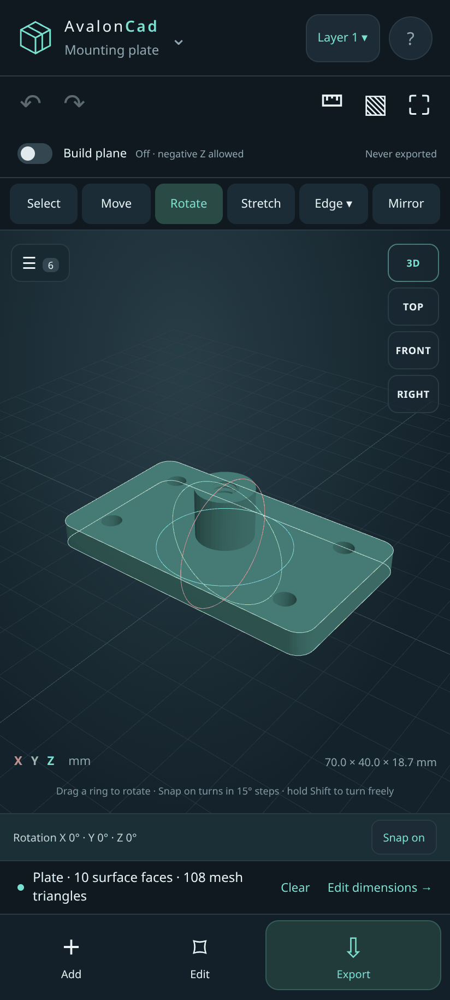
  &nbsp;&nbsp;
  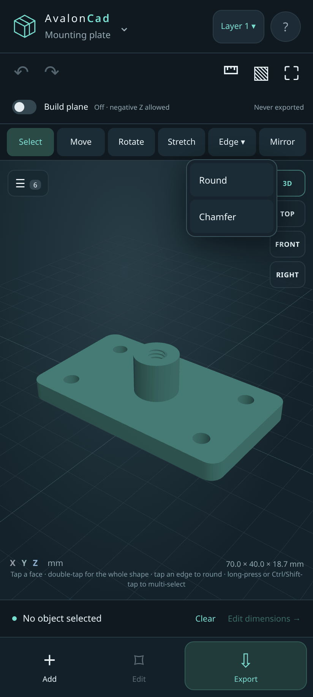
  &nbsp;&nbsp;
  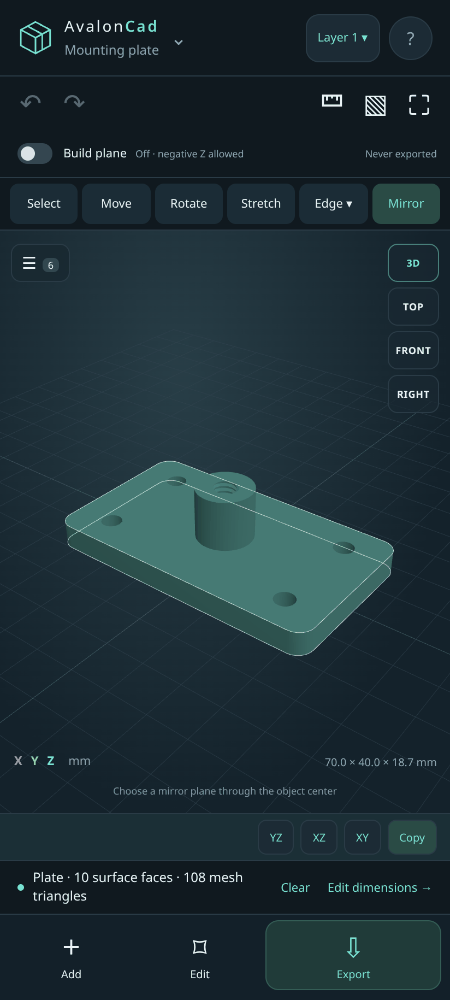
</p>

*Left: Rotate mode shows three rings around the selected shape. Middle: the **Edge ▾** button opens a Round / Chamfer menu. Right: Mirror mode with the YZ, XZ and XY plane buttons and the Copy toggle.*

- **Select:** tap a face to highlight it, double-tap to select the whole shape. Long-press (phone) or Ctrl/Shift-click (desktop) adds shapes to a multi-selection.
- **Move:** drag the shape or an X / Y / Z handle. **Snap on** shows center markers, and **Align centers** places shapes exactly against each other.
- **Rotate (R):** drag one of three world-axis rings. **Snap on** turns in 15° steps, hold Shift to turn freely, and the live readout shows the angle. Each turn is one Undo step.
- **Stretch:** pull a face along its local axis, or use **Set size** to type an exact dimension. The opposite side stays put.
- **Edge ▾ (F): Round or Chamfer.** Tap an edge once for that edge, twice for the face perimeter, three times for every edge. Then drag, or type an exact radius (Round) or distance (Chamfer). Both are real solid operations that end up in the export. **Remove selected chamfers** takes chamfers off again.
- **Mirror:** mirror the selected object across the YZ, XZ or XY plane through its center. **Copy** (on by default) adds the mirrored copy, and turning it off mirrors in place.
- **Undo / Redo** covers every change, and live measurements appear while you drag.
- **Views and camera:** 3D, TOP, FRONT and RIGHT, a fit button and a wireframe toggle. On a phone, pinch to zoom and use two fingers to pan. On desktop, scroll to zoom and right-drag to pan.

<p align="center">
  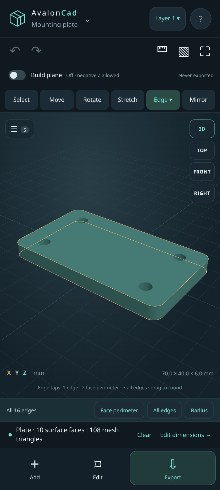
</p>

*Triple-tap an edge to select every edge on the shape, then drag or type a radius.*

### Measure

<p align="center">
  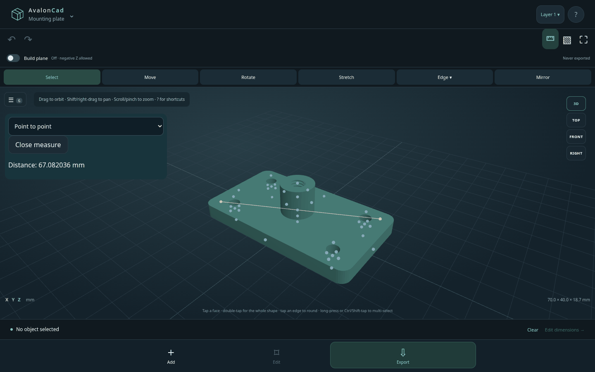
</p>

*The ruler button (T) opens Measure. Here two points on the plate gave "Distance: 67.082036 mm".*

Choose a mode in the panel: **Point to point**, **Face distance and angle**, **Edge length / circle diameter** or **Object minimum distance**, then tap one or two targets.

### Import: STL and 3MF, with Cancel

<p align="center">
  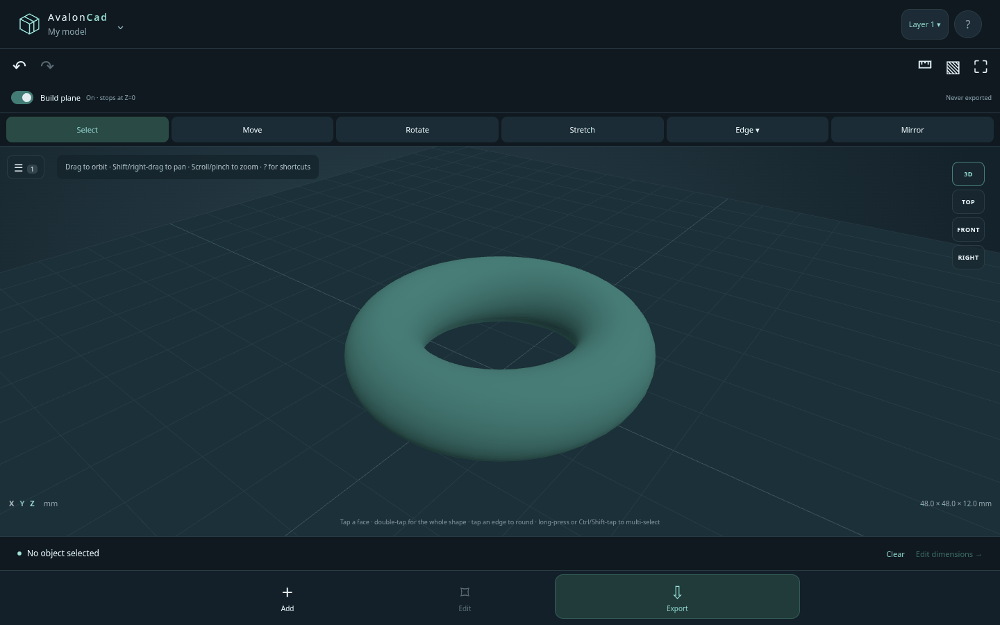
</p>

*A ring imported from a `.3mf` file, after Apply.*

<p align="center">
  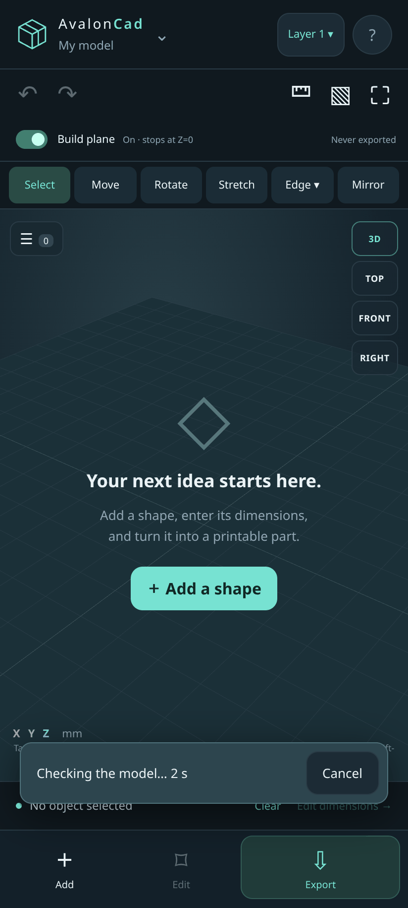
</p>

*An import that takes longer than 2 seconds shows a job bar with a Cancel button. This capture used the test-only import delay hook that the tests use to hold an import.*

- **Add → Import an STL, project or prefab** (or Ctrl/Cmd+O on desktop) opens `.stl` and `.3mf` meshes as well as `.tcad` projects and `.avprefab` prefabs. The 3MF format is recognised by its content, and colours, materials, beam lattices and slices in a 3MF file are ignored.
- Choose a placement and tap **Apply** to add the mesh. An imported mesh keeps its original dimensions, and you can position, rotate and stretch it, or use it as a solid or a cutout. STL files are welded exactly on import.
- Anything slower than 2 seconds (a check, an export or an import) shows **Cancel** in the job bar. Cancel leaves the model unchanged, and a job that has not finished after 2 minutes is stopped the same way.
- Limits: 1 million triangles per imported mesh, 50 MB per file, and 100 objects per project.

### Letters, numbers and symbols with a plate

<p align="center">
  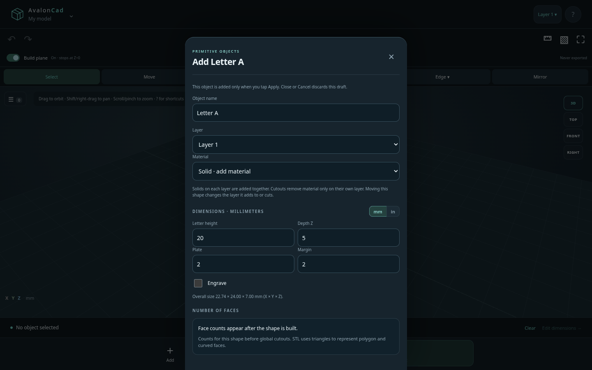
</p>

<p align="center">
  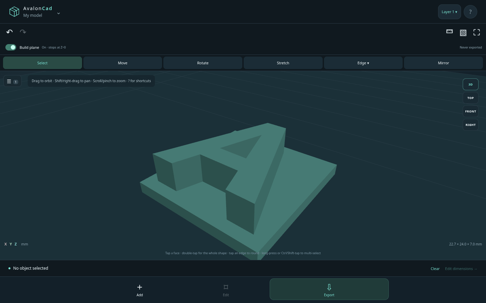
</p>

*The letter A with a 2 mm plate and a 2 mm margin. The sheet reports "Overall size 22.74 × 24.00 × 7.00 mm (X × Y × Z)." Letters are Roboto Bold (SIL OFL 1.1).*

**Add → Letters, numbers & symbols** opens a sheet with **Letter height**, **Depth Z**, **Plate** and **Margin**. New letters start with a 2 mm plate and a 2 mm margin and are embossed. Tick **Engrave** to cut the letter into the plate (it needs a plate thicker than 1 mm). Set the plate to 0 for a plain letter. There is no letter bevel. A letter moves, resizes and rounds like any other shape.

### Hollow (shell) objects

<p align="center">
  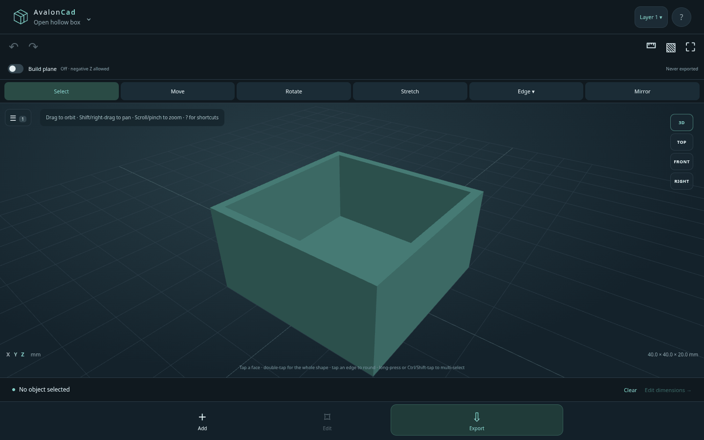
</p>

<p align="center">
  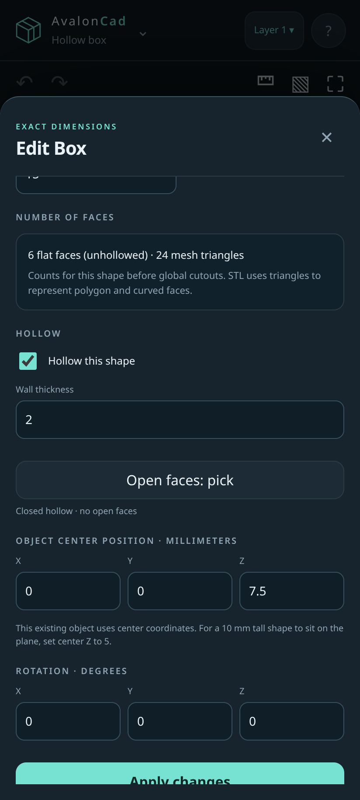
</p>

*A 40 × 40 × 20 mm box hollowed with a 2 mm wall and its top face left open, and the Hollow section of the Edit sheet.*

In an object's **Edit** sheet, tick **Hollow this shape**, set the **Wall thickness**, and use **Open faces: pick** to leave faces open. The wall must be at least 0.4 mm and less than half of the smallest dimension. Hollow is offered for most built-in shapes, sketches and letters. It is not offered for threads, imported meshes, merged shapes, prefabs, letters with a plate or shapes with chamfers. If a hollow cannot be built, you get "Can't hollow this shape at N mm. Try a smaller wall or remove rounds." and the model stays as it was.

### Objects panel, multi-select, groups, Merge and Create Prefab

<p align="center">
  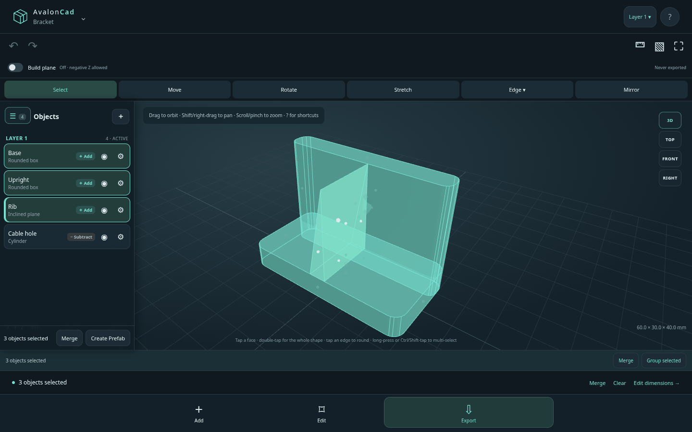
</p>

*Ctrl/Shift-click on desktop, or long-press on a phone, to select several shapes at once.*

- The **☰** button at the corner of the 3D view opens the **Objects** panel: every shape grouped by layer, with show/hide and properties for each one. Selection is shared both ways with the 3D view.
- **Merge** joins the selected shapes into one physically connected solid. By default, merged material fills any cutouts it overlaps. Turn on **Keep existing holes from overlapping Cutout shapes** to keep those holes. If the pieces don't touch, Merge can add connecting bars of a diameter you choose.
- **Group selected** (Ctrl/Cmd+G) and **Ungroup** (Ctrl/Cmd+Shift+G) keep objects together, and a group can be renamed.
- **Create Prefab** saves the selection as a reusable prefab in one step.

<p align="center">
  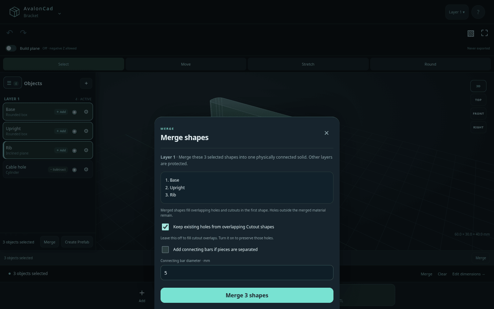
</p>

### Layers, prefabs and the build plane

<p align="center">
  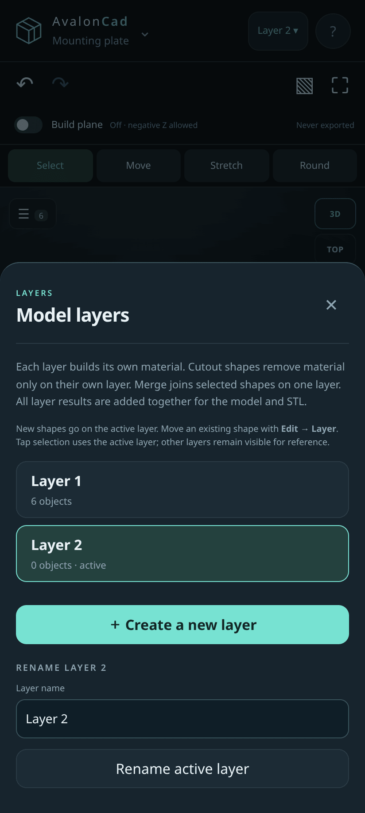
  &nbsp;&nbsp;
  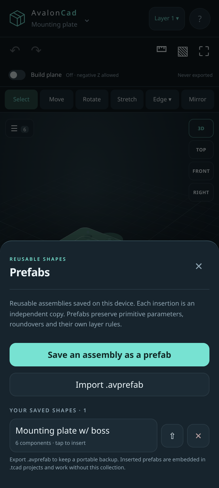
</p>

*Layers: each layer builds its own material, and cutouts only cut their own layer. Prefabs: save assemblies once and insert independent copies anywhere.*

- **Layers:** create and rename layers with the layer button at the top. New shapes go on the active layer, and **Edit → Layer** moves a shape to another one. All layers are added together for the preview and the export.
- **Prefabs:** save a selection, a layer or the whole model from **Add → Prefabs** or with **Create Prefab**. Each insertion is an independent copy. Export and import portable **.avprefab** files, and use **Edit → Separate components** to turn an inserted prefab back into editable shapes.

<p align="center">
  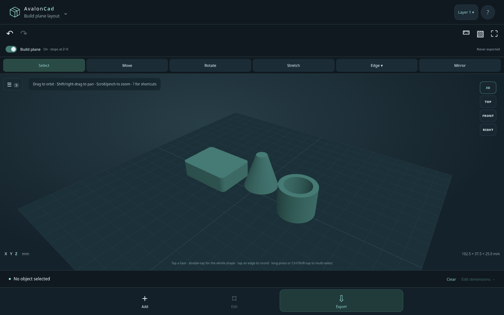
</p>

*With the build plane on, nothing can sink below Z = 0. The plane is only a visual guide and is never exported.*

### Overhang view

<p align="center">
  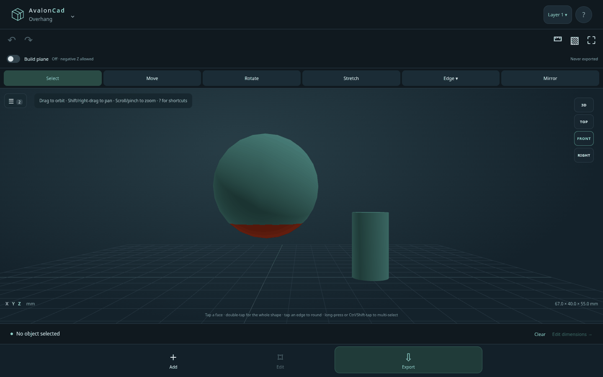
</p>

*The Overhang toggle in the View sheet marks downward-facing surfaces.*

Double-tap a view button (3D, TOP, FRONT or RIGHT) to open the **View** sheet and turn on **Overhang**. Downward-facing surfaces steeper than 45° are shown in red, and the Export sheet reports their area ("Overhang: N cm²"). Faces that rest on the build plate are not counted.

### Export: STL and 3MF

<p align="center">
  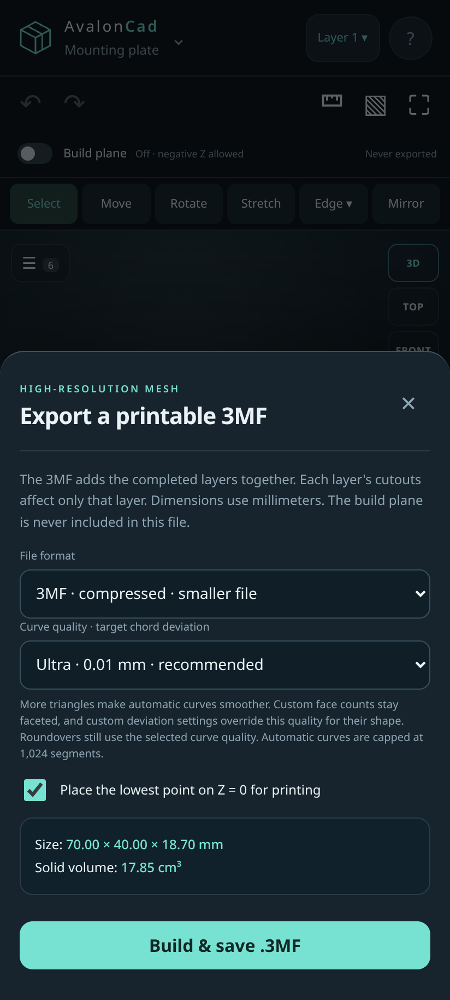
</p>

*Choose the file format and curve quality, put the part flat on Z=0, and check its size and volume before saving.*

| Quality | Target chord deviation |
| --- | --- |
| Draft | 0.15 mm |
| Fine | 0.03 mm |
| Ultra | 0.01 mm |
| Maximum | 0.005 mm |

- **File format:** **STL · binary · most compatible** or **3MF · compressed · smaller file**. Both are in millimeters, with outward-facing normals. Automatic curves are capped at 1,024 segments. The 50 MB file-transfer limit applies.
- **Place the lowest point on Z = 0 for printing** drops the whole export onto the bed.
- Separate parts export together as separate closed shells.

### Keyboard shortcuts and tooltips

Press **?** for Help, which lists the shortcuts: **V** Select, **M** Move, **R** Rotate, **S** Stretch, **F** Edge, **T** Measure, **A** Add, **W** wireframe, **0** or **Home** fit the view, **Delete** or **Backspace** deletes, **Shift+Delete** clears the selection, **Ctrl/Cmd+D** duplicate, **Ctrl/Cmd+Z** undo, **Ctrl/Cmd+Shift+Z** (or Ctrl+Y) redo, **Ctrl/Cmd+S** save, **Ctrl/Cmd+Shift+S** export the project, **Ctrl/Cmd+O** open, **Ctrl/Cmd+N** new project, **Ctrl/Cmd+E** export, and **Esc** closes a sheet or clears the selection. Shortcuts also work with a hardware keyboard on Android and never fire while you type in a field. Every button has a tooltip that names its shortcut; on a touch screen, long-press a button to see it.

### Projects and backups

- Your work autosaves on the device. You can keep named projects and export portable, editable **.tcad** files.
- Projects from AvalonCad 2.4 and earlier are **upgraded automatically** when you open them, and the old autosave is backed up first.
- Projects that use a 3.0 feature (mirror, hollow, chamfer, a letter plate) are saved in project format v3 and cannot be opened by 2.7.x. Other projects are saved as before.
- If AvalonCad hits a problem and restarts, it reopens your last autosave.
- Limits: 100 objects per project, 300 points per sketch, 1 million triangles per imported mesh and 50 MB file transfers.
- Not supported: constraint solving, STEP files and automatic mesh repair.

## Install

Download the latest build from the [**GitHub Releases**](https://github.com/AvalonWaveSoftware/Avalon-CAD/releases) page. The app ID is `com.avalonwavesoftware.cad` on every platform.

### Verify your download

Every release includes `SHA256SUMS`, a detached signature `SHA256SUMS.asc` and the public key `avalonwave-release-signing.pub.asc`. The RPM and the pacman package are signed with the same AvalonWave release key (fingerprint `340A2A9E44A56B41725545785169139218FA2E7D`); the pacman signature is the `.sig` file beside the package. The APK is signed with the Android release key, and the Mac zip is not signed or notarized.

```bash
gpg --import avalonwave-release-signing.pub.asc
gpg --verify SHA256SUMS.asc SHA256SUMS
sha256sum -c --ignore-missing SHA256SUMS
# Fedora only: import the key into rpm, then check the package signature
sudo rpm --import avalonwave-release-signing.pub.asc
rpm -K avalon-cad-3.0.0.x86_64.rpm
```

### Android (APK)

Android 9 or later is required, and Android System WebView must support WebGL 2. Download `AvalonCad-3.0.0.apk`, open it from **My Files → Downloads** and choose **Install**.

- **3.0 is a new app, not an update.** It has a new app ID (`com.avalonwavesoftware.cad`, which replaces `com.tristan.cad`) and a new signing key, so it installs next to 2.7.x and starts with no projects. To bring a project over, open it in 2.7.x, save it to a file, then open that file in 3.0. Once your projects are moved you can uninstall 2.7.x. Later 3.x releases install over 3.0 as usual.
- **Uninstalling** deletes local projects and prefabs. Export .tcad and .avprefab backups first.
- The app has no Internet permission and never goes online.

### Fedora (RPM)

Download `avalon-cad-3.0.0.x86_64.rpm`, then:

```bash
sudo dnf install ./avalon-cad-3.0.0.x86_64.rpm
```

The package installs to `/opt/Avalon CAD`, adds an `avalon-cad` launcher in `/usr/bin` and an **Avalon CAD** desktop entry. Start it from your application menu or with `avalon-cad`. Your data stays in `~/.config/Avalon CAD/`. Remove it with `sudo dnf remove avalon-cad`. WebGL 2 is required; if your GPU driver misbehaves, start it with `AVALON_SOFTWARE_GL=1 avalon-cad` to use software rendering.

### Arch Linux (pacman, Wayland)

Download `avalon-cad-3.0.0-1-x86_64.pkg.tar.zst`, then:

```bash
sudo pacman -U avalon-cad-3.0.0-1-x86_64.pkg.tar.zst
```

pacman installs the declared runtime dependencies (gtk3, nss, alsa-lib, libxss, mesa and others) and puts the app in `/opt/Avalon CAD` with the same `avalon-cad` launcher and desktop entry as the RPM. Remove it with `sudo pacman -R avalon-cad`.

**Wayland:** AvalonCad is an Electron app. The package has no Wayland-specific launcher, option or setting, and 3.0 has not been tested on a real Wayland session (the desktop tests ran under X11 with a virtual display). Known limit: on a session that does not report a mouse or touchpad, the mouse-controls help line may not show. If the window renders badly, try `AVALON_SOFTWARE_GL=1 avalon-cad` (software rendering) and please report what you see.

### macOS (Apple silicon)

1. Download `AvalonCad-3.0.0-Mac-AppleSilicon.zip` and double-click it to extract it.
2. Move **AvalonCad.app** to **Applications** and open it. It needs an Apple-silicon Mac and macOS 13 or later, and everything it needs is bundled. Intel Macs are not supported.
3. **First launch:** the app ships ad-hoc signed and is **not notarized by Apple**. If macOS blocks the first launch, go to **System Settings → Privacy & Security** and click **Open Anyway** for AvalonCad, then confirm. On macOS 14 and earlier you can instead right-click (Control-click) the app and choose **Open**. See [Apple's guide](https://support.apple.com/en-us/102445). You don't need to change your system-wide Gatekeeper setting.
4. The bundle ID is now `com.avalonwavesoftware.cad`, so macOS may ask again for file access, may not restore the old window position, and a default "Open with" for .tcad, .avprefab and .stl files may need to be set again.

**Mac controls:** left-drag to orbit. Right-drag, Shift-drag or Cmd/Ctrl-drag to pan. Scroll or pinch to zoom.

| Shortcut | Action |
| --- | --- |
| Cmd+N | New project |
| Cmd+O | Open a .tcad, .avprefab, .stl or .3mf file |
| Cmd+S | Save |
| Cmd+Shift+S | Export .tcad |
| Cmd+E | Export (STL or 3MF) |
| Cmd+Z / Cmd+Shift+Z | Undo / Redo |
| Cmd+Shift+A | Primitive Objects |
| Cmd+0 | Fit view |
| Esc | Close a panel or clear selection |

To move work between devices, export a .tcad from your phone and open it on the desktop with Cmd/Ctrl+O.

## How it works

AvalonCad is a web app bundled inside each platform's own app shell: an Android WebView, or Electron on desktop. It runs entirely offline:

- **Python (Pyodide, CPython 3.13.2)** handles model assembly and Boolean jobs in a background worker.
- **Rust compiled to WebAssembly** builds threaded solids, prepares preview meshes and normals, welds imported STL meshes, measures, and writes binary STL and 3MF.
- **OpenCascade** (via replicad) and **Manifold** provide solid modeling, Booleans, rounds, chamfers and hollows.
- **three.js** draws the WebGL 2 viewport.

The Android app has **no internet permission**. The desktop shells block every outside request. There are no accounts, ads or analytics, and nothing is downloaded at runtime.

## Building from source

The source tree contains the Python and Rust engine source, web and Android code, bundled runtime assets, tests and dependency lockfiles. Python job code lives in `engine/python/model_jobs.py`, and the Rust engine is in `engine/rust/src/`. The CAD kernel is a separate WASM asset that can be rebuilt from its upstream source.

### Android APK (Linux)

Install Node.js 20 or later (24+ recommended for development), a Java 17 JDK, and Rust 1.90.0 with its `wasm32-unknown-unknown` target. Install the Android command-line tools into `tools/android-sdk/cmdline-tools/latest`, or set `TRISTANCAD_SDK` to your SDK. Then install `platforms;android-35` and `build-tools;35.0.0` with `sdkmanager`, accepting the license when prompted.

```bash
rustup toolchain install 1.90.0 --profile minimal --target wasm32-unknown-unknown
npm ci
./build-rust.sh
cargo test --locked --offline --manifest-path engine/rust/Cargo.toml --target-dir build/rust-target
npm test
./build-apk.sh
```

The APK is written to a sibling `deliverables/` directory as `AvalonCad-3.0.0.apk`. `./build-apk.sh --test-key` builds a test APK (`AvalonCad-3.0.0-test.apk`, app ID `com.avalonwavesoftware.cad.test`) with a throwaway test key instead. The Rust crate's only dependency, miniz_oxide (DEFLATE for 3MF export, with its adler2 dependency), is vendored in `engine/rust/vendor` (see `.cargo/config.toml`), so it builds offline once the pinned compiler and target are installed. The build pins Pyodide 0.29.3 (CPython 3.13.2) and bundles its unmodified runtime with full license notices.

**Signing:** the release APK is signed with the private key `tools/signing.p12`. Set its password in the `AVALONCAD_KEYSTORE_PASS` environment variable before running `build-apk.sh`, because the password is not stored in the repository. Keep the same key for every release so new APKs can update installed apps. If the key is missing, `build-apk.sh` stops instead of silently creating a new one; set `AVALON_ALLOW_NEW_KEY=1` only if you really mean to create one. **Never commit the signing key or its password**, and keep any source backup that contains the key private.

### Desktop

- **Mac:** on a Mac with Node.js 24+, run `npm ci` and then `npm run build:mac`. This builds the web assets, downloads a pinned Electron runtime and checks its SHA-256, packages an arm64 `AvalonCad.app` and signs it locally with `codesign` (ad hoc). For cross-platform signing, set `AVALON_RCODESIGN` to an apple-codesign executable and `AVALON_ELECTRON_CACHE` to a folder containing the verified runtime ZIP. The script writes the app bundle to `build/mac/`; zipping it for distribution is a separate step.
- **Linux:** run `desktop/build-rpm.sh` (writes `avalon-cad-<version>.x86_64.rpm`) or `desktop/build-arch.sh` (writes `avalon-cad-<version>-1-x86_64.pkg.tar.zst`) into the sibling `deliverables/` directory. Add `--skip-web` to reuse the existing `app/assets`. See [desktop/README.md](desktop/README.md) for the requirements and a headless smoke test.

### Tests

- `app/assets` is generated and not tracked (except `mesh-core.wasm`): run `npm run build:web` before `npm test` or the browser tests. The packaging scripts always build it.
- The first `npm run build:web` on a machine runs binaryen `wasm-opt -Oz` on the OCCT and Manifold binaries (about 4 minutes, up to ~8 GB of memory); the result is cached in `build/wasm-opt`. `tools/npm-stubs` holds empty stand-ins for install-only dependencies (see its README).
- `npm test` runs the geometry, interaction, import, export, layer, prefab, thread, build-plane, Objects panel and migration suites in Node using jsdom. Node 24 is recommended.
- `npm run test:browser` is an optional integration test with real WebGL. Install Playwright separately (`npm install --no-save playwright`) and set `AVALON_CHROMIUM` to a local Chromium executable. It serves the bundled assets from localhost only and blocks all outside requests. This test server is a development tool and is not part of the installed app.
- `npm run test:pixels` runs the string and DOM baseline, the letters sheet layout test and the pixel comparison against a baseline set (`AVALON_PIXEL_BASELINE`) on a phone viewport (412×915 at 2×) and a desktop viewport (1440×900).
- `tools/readme-shots/` contains the Playwright script that produces the screenshots in this README (see its README).

## License

AvalonCad is released under the [BSD-3-Clause license](LICENSE). Bundled third-party components keep their own licenses. See [THIRD_PARTY_NOTICES.txt](THIRD_PARTY_NOTICES.txt) and the [licenses/](licenses/) folder.

See [CHANGELOG.md](CHANGELOG.md) for the release history.
